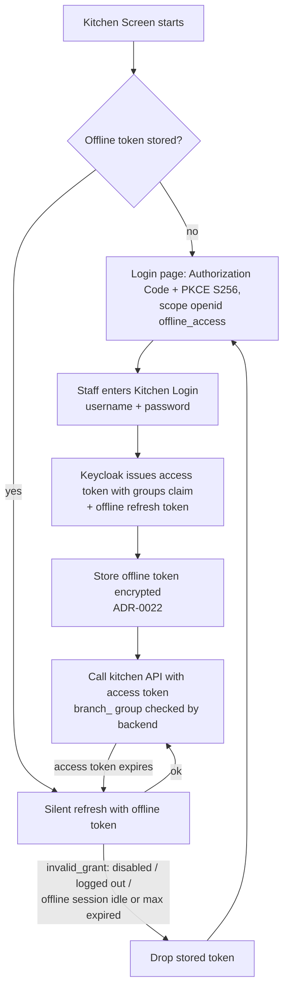

# Kitchen Screen Keycloak provisioning

How the backend provisions Kitchen Screen access in Keycloak (issue #183). A Merchant Manager enables the Kitchen Screen for a Branch in the web admin. The backend sets up Keycloak and returns the **Kitchen Login** once. No manual Keycloak steps are needed, except the realm-wide offline session settings.

Code: `merchant.iam` — `KitchenAccessController`, `KitchenAccessService`, `KitchenPasswordGenerator`, `KitchenAccessProperties`. It reuses the existing Keycloak admin client (`KeycloakAdminClientConfig`) and the branch-group sync (`MerchantGroupSyncService`).

## Endpoints

All three are under `/v1/merchant/branches/{branchId}/kitchen` and send `Cache-Control: no-store`.

| Method | Path | Response |
|---|---|---|
| `POST` | `/enable` | `{ username, password, keycloakUrl, realm, clientId, apiBaseUrl, branchId }` |
| `POST` | `/disable` | `{ enabled: false, username }` |
| `GET` | `/` | `{ enabled, username }` (`username` is null if no Kitchen Login was ever provisioned) |

- **Authorization**: the caller must be a Merchant Manager of the Branch's Merchant (`MerchantCallerResolver` / `MerchantCaller.isManagerFor`, the same rule as Branch opening hours and appearances). Otherwise `403`. Unknown Branch: `404`. Username already bound to another Branch's group: `409`.
- **Enable is idempotent.** Calling it again resets the password, which is how "Reset password" works in the web admin.
- **Password**: 24 bytes from `SecureRandom`, base64url (32 URL-safe characters). It exists only in the `enable` response. The backend never stores or logs it, and `KitchenLoginResponse.toString()` masks it. The web admin shows it once (masked, with a reveal toggle and a copy button). After that the only option is to reset it.
- **Username**: `kitchen-<branch code, lower case>`, e.g. `kitchen-br-1a2b3c4d5e6f`. It contains no UUID (ADR-0012).

## Configuration

| Property | Env | Default |
|---|---|---|
| `keycloak.iam.kitchen.client-id` | `KEYCLOAK_IAM_KITCHEN_CLIENT_ID` | `blitzpay-kitchen` |
| `keycloak.iam.kitchen.redirect-uri` | `KEYCLOAK_IAM_KITCHEN_REDIRECT_URI` | `app://kitchen/renderer/index.html` |
| `keycloak.iam.kitchen.api-base-url` | `API_BASE_URL` (falls back to `STRIPE_CONNECT_API_BASE_URL`) | `http://localhost:8080` |
| `keycloak.iam.kitchen.email-domain` | — | `kitchen.invalid` |

`keycloakUrl` and `realm` in the response come from `keycloak.iam.server-url` / `keycloak.iam.realm`. In Kubernetes the chart derives `API_BASE_URL` from `global.baseDomain` (`https://api.<baseDomain>`).

## Required Keycloak admin roles

The service account behind `KEYCLOAK_IAM_ADMIN_CLIENT_ID` needs these `realm-management` client roles:

| Role | Why |
|---|---|
| `manage-clients` | Create or update the kitchen client, its protocol mappers and client scopes, and list the realm client scopes (it includes view access to clients) |
| `manage-users` | Create, update, enable or disable the kitchen user, reset its password, set group membership, log it out and revoke its offline token (it includes view access to users) |
| `query-groups` | Look up the `merchants` / `merchant_<id>` / `branch_<id>` groups (already needed by the group sync) |

`view-realm` is not needed. The realm config lives outside this repo, so grant the roles manually in Keycloak: Clients → admin client → Service account roles → Assign role → filter by clients → `realm-management`.

## Enable / reset password

```mermaid
sequenceDiagram
    autonumber
    actor M as Merchant Manager
    participant W as Web admin
    participant B as Backend (merchant.iam)
    participant K as Keycloak Admin API

    M->>W: Enable Kitchen Screen / Reset password
    W->>B: POST /v1/merchant/branches/{branchId}/kitchen/enable
    B->>B: load Branch (404 if unknown)
    B->>B: caller is Merchant Manager of Branch's Merchant? (403 if not)

    Note over B,K: 1. Realm client (never deleted: that would end every kitchen offline session)
    B->>K: GET /clients?clientId=blitzpay-kitchen
    alt client missing
        B->>K: POST /clients (public, standard flow, no direct grants,<br/>PKCE S256, redirect + post-logout URI, webOrigins "+")
    else client exists
        B->>K: PUT /clients/{id} (same settings, overwritten in place;<br/>other attributes kept)
    end
    B->>K: GET /clients/{id}/protocol-mappers/models
    alt "groups" group-membership mapper exists
        B->>K: PUT .../models/{mapperId} (claim groups, access token, full.path=false)
    else missing
        B->>K: POST .../models (create "groups" mapper)
    end
    B->>K: DELETE other mappers emitting the "groups" claim (no duplicates)
    B->>K: GET /client-scopes, GET client's default/optional scopes
    opt offline_access not optional yet
        B->>K: DELETE .../default-client-scopes/{offline_access} (only if it was default)
        B->>K: PUT .../optional-client-scopes/{offline_access}
    end

    Note over B,K: 2. Branch group (MerchantGroupSyncService)
    B->>K: ensure /merchants/merchant_{merchantId}/branch_{branchId}

    Note over B,K: 3. Kitchen user kitchen-<branchcode>
    B->>K: GET /users?username=kitchen-…&exact=true
    alt user missing
        B->>K: POST /users (enabled, no required actions, verified placeholder email)
    else user exists
        B->>K: GET /users/{id}/groups (409 if bound to another branch_ group)
        B->>K: PUT /users/{id} (enabled=true, required actions cleared)
    end
    B->>K: PUT /users/{id}/groups/{branchGroupId}
    B->>B: generate password (SecureRandom, never stored or logged)
    B->>K: PUT /users/{id}/reset-password (temporary=false)

    B-->>W: 200 Cache-Control: no-store<br/>{ username, password, keycloakUrl, realm, clientId, apiBaseUrl, branchId }
    W-->>M: show once: masked password + reveal toggle + copy, run settings
```

A password reset doesn't end the Kitchen Screens' existing sessions. Screens that are already logged in keep working through their offline token. The new password only matters for the next interactive login. To force every screen to log in again, disable and then enable.

## Disable

```mermaid
sequenceDiagram
    autonumber
    actor M as Merchant Manager
    participant W as Web admin
    participant B as Backend (merchant.iam)
    participant K as Keycloak Admin API
    participant S as Kitchen Screen

    M->>W: Disable Kitchen Screen
    W->>B: POST /v1/merchant/branches/{branchId}/kitchen/disable
    B->>B: load Branch (404) + Merchant Manager check (403)
    B->>K: GET /users?username=kitchen-…&exact=true
    alt no kitchen user
        B-->>W: 200 { enabled: false, username: null }
    else kitchen user exists
        B->>K: PUT /users/{id} (enabled=false)
        B->>K: POST /users/{id}/logout (removes all user sessions)
        B->>K: DELETE /users/{id}/consents/blitzpay-kitchen (revokes the offline token; 404 = none, ignored)
        B-->>W: 200 Cache-Control: no-store { enabled: false, username }
    end
    S->>K: next token refresh with offline token
    K-->>S: 400 invalid_grant (session gone / user disabled)
    S->>S: back to the login page
```

## Kitchen Screen login lifecycle



The offline session idle and max lifetimes are realm settings (Realm settings → Sessions). Set them by hand once. They are not provisioned by this API.
